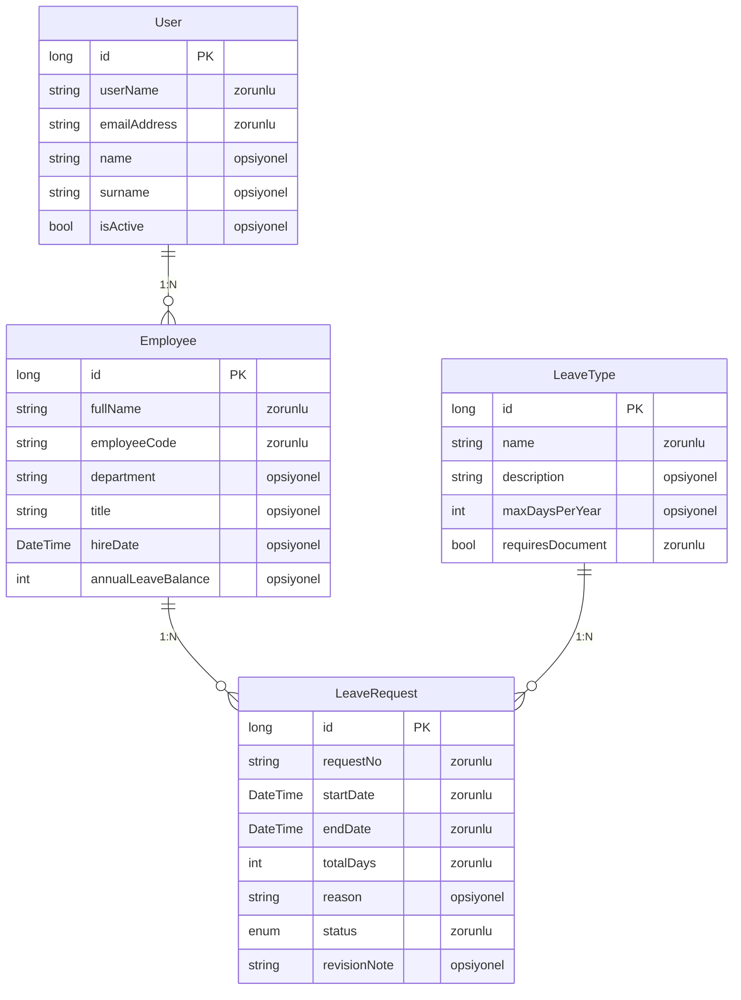
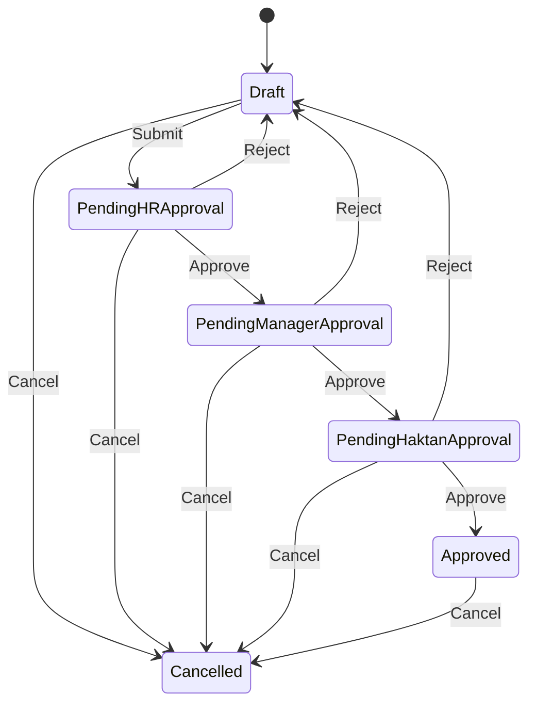
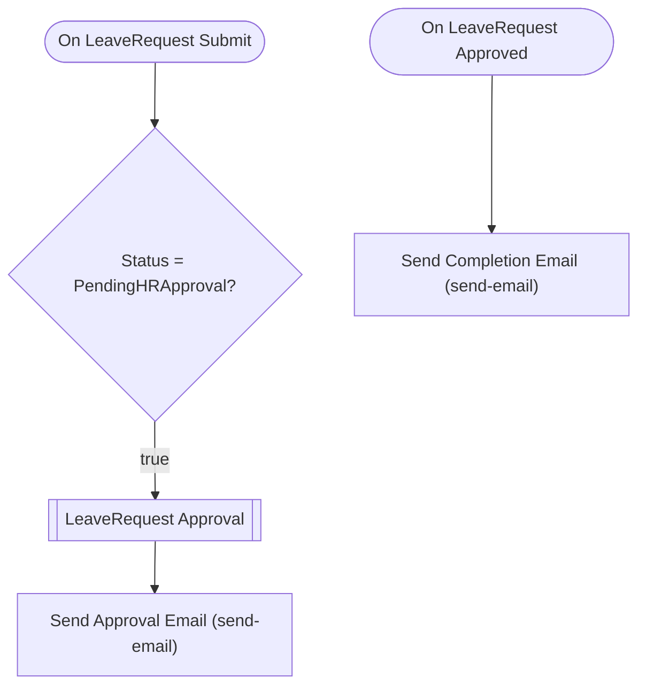

# i̇zin-yönetim-sistemi — Talep Analizi

> Bu belge Archipid talep olgunlaştırma (discovery) akışıyla üretildi.

## Orijinal Talep

iki onay adımlı bir izin yönetim sistemi istiyorum

## Özet

Bu uygulama, şirket çalışanlarının izin taleplerini dijital ortamda oluşturmasını, doğrudan yöneticisine ve ardından İnsan Kaynakları ekibine otomatik iletmesini ve onay sürecini şeffaf biçimde takip etmesini sağlar.

Çalışan izin başlangıç/bitiş tarihlerini ve izin türünü seçerek talebini oluşturur ve gönderir; sistem talebi otomatik olarak çalışanın doğrudan yöneticisine iletir. Yönetici talebi onaylarsa İK uzmanına iletilir; İK da onaylarsa izin kesinleşir. Yönetici revize isterse talep çalışana geri döner ve yönetici adımından devam eder; İK revize isterse talep yine çalışana döner ancak bu kez İK adımından devam eder. Her iki onaycı da talebi doğrudan reddedebilir; reddedilen talep çalışan tarafından düzeltilip yeniden gönderilebilir. İzin türleri (yıllık izin, mazeret izni vb.) yönetici tarafından önceden sisteme tanımlanır.

## Kapsam

- (belirtilmedi)

## Kapsam Dışı

- (belirtilmedi)

## Açık Noktalar

- (belirtilmedi)

## Eksiklikler

- (belirtilmedi)

## Öneriler

- (belirtilmedi)

## Veri Modeli

### User — Kullanıcı (Sistem)

| Alan | Tip | Zorunlu | Uzunluk |
|---|---|---|---|
| `id` | long | Evet | — |
| `userName` | string | Evet | 64 |
| `emailAddress` | string | Evet | 256 |
| `name` | string | Hayır | 128 |
| `surname` | string | Hayır | 128 |
| `isActive` | bool | Hayır | — |

**Neye bağlı:** Employee (1:N, bu tablo "bir" tarafı)

### LeaveType — İzin Türü

| Alan | Tip | Zorunlu | Uzunluk |
|---|---|---|---|
| `id` | long | Evet | — |
| `name` | string | Evet | 100 |
| `description` | string | Hayır | 500 |
| `maxDaysPerYear` | int | Hayır | — |
| `requiresDocument` | bool | Evet | — |

**Neye bağlı:** LeaveRequest (1:N, bu tablo "bir" tarafı)

### LeaveRequest — İzin Talebi

| Alan | Tip | Zorunlu | Uzunluk |
|---|---|---|---|
| `id` | long | Evet | — |
| `requestNo` | string | Evet | 50 |
| `startDate` | DateTime | Evet | — |
| `endDate` | DateTime | Evet | — |
| `totalDays` | int | Evet | — |
| `reason` | string | Hayır | 1000 |
| `status` | enum (Draft,PendingHRApproval,PendingManagerApproval,PendingHaktanApproval,Approved,Cancelled) | Evet | — |
| `revisionNote` | string | Hayır | 1000 |

**Neye bağlı:** Employee (1:N, bu tablo "çok" tarafı) · LeaveType (1:N, bu tablo "çok" tarafı)

### Employee — Çalışan

| Alan | Tip | Zorunlu | Uzunluk |
|---|---|---|---|
| `id` | long | Evet | — |
| `fullName` | string | Evet | 200 |
| `employeeCode` | string | Evet | 50 |
| `department` | string | Hayır | 100 |
| `title` | string | Hayır | 100 |
| `hireDate` | DateTime | Hayır | — |
| `annualLeaveBalance` | int | Hayır | — |

**Neye bağlı:** User (1:N, bu tablo "çok" tarafı) · LeaveRequest (1:N, bu tablo "bir" tarafı)

## İş Akışları

### İzin Talebi — durum makinesi

**Onay adımları**

| # | Adım | Atanan | Aksiyonlar | Zorunlu alanlar |
|---|---|---|---|---|
| 1 | İK Uzmanı Onayı | Rol: `HRSpecialist` | Onayla (approve), Reddet (reject) | `revisionNote` |
| 2 | Yönetici Onayı | Rol: `Manager` | Onayla (approve), Reddet (reject) | `revisionNote` |
| 3 | Haktan Onayı | Rol: `Haktan` | Onayla (approve), Reddet (reject) | `revisionNote` |

Tanımlı bir red/revizyon geçişi yok.

### Akış: LeaveRequest Approval Flow

Auto-generated approval flow for LeaveRequest. Customize email templates and add conditions as needed.

## Elle Geliştirme Gerektirenler

Aşağıdaki maddeler senaryonun gereği ama üretilen koda yansımıyor — kod yazılması gerekir.

| Alan | İş | Neden | Geçici çözüm |
|---|---|---|---|
| entity | Talep numarası otomatik üretimi | Sıralı/formatlı numara (ör. IZN-2025-0001) üretimi desteklenmiyor; alan düz string olarak saklanır. | Kullanıcı talep numarasını kendisi girsin veya sistem varsayılan ID'yi kullansın. |
| validation | Yıllık izin bakiyesi kontrolü | Talep edilen gün sayısının çalışanın kalan bakiyesini aşıp aşmadığı iş kuralı olarak üretilemiyor. | Onaycılar bakiyeyi dashboard'daki Employee kaydından manuel kontrol etsin. |
| approval | Revizyon adımında sadece revize isteyen onaycıya dönüş | Approval engine revize isteyen adımı otomatik olarak ayırt eder; RevisionByManager ve RevisionByHR ayrı durum olarak modellendi. Revize sonrası yeniden gönderimde yalnızca ilgili adıma dönülür ancak bunun engine tarafında doğru eşleşip eşleşmediği konfigürasyon gerektiriyor. | RevisionByManager → PendingManagerApproval ve RevisionByHR → PendingHRApproval geçişleri ayrı Resubmit action'larıyla tanımlandı; sistem bu state'lere göre doğru adımı bulmalıdır. |
